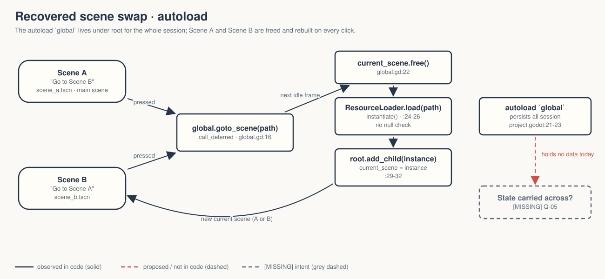
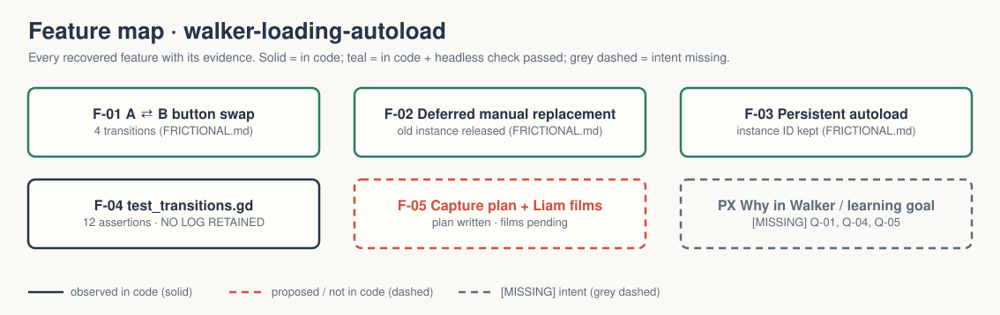

# walker-loading-autoload — Game Design Document (recovered)

| | |
|---|---|
| Version | 0.1.0-recovered |
| Date | 2026-09-27 |
| Author | Zelda (agent, silent), for Nik Bear Brown |
| Mode | recovered — `/gdd reverse --path godot silent` |
| Revision | 1 |
| Gates | gate — unsigned at time of writing · vision ○ · systems ○ · world ○ · scope ○ |
| Source | Godot demo `loading/autoload`, checkout `a3b5c113112f77291d5f3d1360f33a882fdc52f7`; Walker change is the project title only |
| What this is | **A tech demo, not a game.** Two screens and a persistent autoload that swaps between them by hand. |

Provenance tags: `[OBSERVED path:line]` the code or a project file does this · `[INFERRED]` the code strongly implies this, evidence stated · `[MISSING]` nothing in the folder can tell us this; each one is an open question in `design/decisions.md`. Paths are relative to the project folder (the folder that contains `godot/`). This file is identical at `GDD.md` and `design/GDD.md`.

A recovered GDD describes what exists. It approves nothing.

Evidence image: `godot/screenshots/autoload.png` (1152×648 greyscale) is the **upstream** screenshot retained with the copy `[OBSERVED README.md:4-5]`. It is not a Walker capture; visible capture is pending `[OBSERVED README.md:12; CAPTURE-PLAN.md:3-5]`.

## 1. Vision summary

**Logline (recovered).** "This demo shows how to use autoloads to change between scenes." `[OBSERVED godot/project.godot:14]`

**What it teaches.** A persistent singleton (`global`) that replaces the current scene manually and safely: defer the swap, free the old scene, load and instance the new one, add it under root, mark it current `[OBSERVED godot/global.gd:7-32]`. The script itself says SceneTree's `change_scene_to_file()` / `change_scene_to_packed()` are the easier normal route; this is the manual version `[OBSERVED godot/global.gd:2-4; README.md:8-10]`.

**What it does not teach.** Saving or carrying player state: the autoload holds no data `[OBSERVED godot/global.gd — no variables]`, and the README says so: it "does not demonstrate saving player state" `[OBSERVED README.md:10]`. It is also not asynchronous or background loading `[OBSERVED CAPTURE-PLAN.md:22-23]`.

**Player fantasy / goal.** None `[OBSERVED — two labels and two buttons]`.

**Why it is in Walker, and for whom.** `[MISSING → Q-01, Q-02]` The folder has a capture plan for a development film `[OBSERVED CAPTURE-PLAN.md]` but no statement of why Walker needs it (a scene-manager pattern for Walker games? a film topic?).

## 2. Design pillars

`[MISSING → Q-03]` None declared. The code implies `[INFERRED from godot/global.gd:8-16 comments]`:
- **Never free the scene you are standing in.** The swap is always deferred until no code from the current scene is running.
- **The manager outlives every scene.** The autoload sits beside the current scene under root and is never replaced.

## 3. Core loop

- **The loop.** Scene A → click "Go to Scene B" → Scene B → click "Go to Scene A" → Scene A, forever `[OBSERVED godot/scene_a.gd:3-4; godot/scene_b.gd:3-4; godot/scene_a.tscn:36; godot/scene_b.tscn:36]`.
- **Under the hood, per click.** `global.goto_scene(path)` → `_deferred_goto_scene.call_deferred(path)` → `current_scene.free()` → `ResourceLoader.load(path)` → `instantiate()` → `root.add_child()` → `current_scene = instance` `[OBSERVED godot/global.gd:7-32]`.
- **Session.** Starts in Scene A `[OBSERVED godot/project.godot:16]`; no end, no save.

## 4. Player Experience Goals

`[MISSING → Q-04]` None declared. The capture plan implies a viewer outcome: understand that the singleton persists while scenes are replaced, and that SceneTree's helpers are the simpler standard `[INFERRED from CAPTURE-PLAN.md:13-23]`. That is a learning goal for a film, not an approved PX goal.

## 5. Mechanics

- **M-01 Button-driven swap** — each scene's button `pressed` signal calls its own `_on_goto_scene_pressed`, which calls `global.goto_scene` with the other scene's path `[OBSERVED godot/scene_a.gd:3-4; godot/scene_b.gd:3-4]`.
- **M-02 Deferred replacement** — `call_deferred` so the current scene is not freed inside its own callback `[OBSERVED godot/global.gd:8-16]`.
- **M-03 Immediate free, synchronous load** — `free()` (not `queue_free()`) then `ResourceLoader.load()` on the main thread `[OBSERVED godot/global.gd:22-24]`. There is no error handling if the path fails to load `[INFERRED — no null check on `packed_scene` before `instantiate()` at line 26]`.
- **M-04 Persistent autoload** — `global="*res://global.gd"` (the `*` makes it a named global) `[OBSERVED godot/project.godot:21-23]`.

## 6. Systems

- **S-01 Scenes.** `scene_a.tscn` and `scene_b.tscn`: a Panel, a Label ("This is scene A." / "This is scene B."), a 24 pt Button with a colored font (yellow-green in A, light blue in B) `[OBSERVED godot/scene_a.tscn:5-36; godot/scene_b.tscn:5-36]`.
- **S-02 Scene manager.** `global.gd` (`extends Node`), two functions, no state `[OBSERVED godot/global.gd:1-32]`.
- **S-03 Input.** No `[input]` section; button `pressed` signals only `[OBSERVED godot/project.godot]`.
- **S-04 Save/load.** None. Scene loading only.
- **S-05 Display.** `canvas_items` stretch, `expand` aspect, vsync off, low-processor mode `[OBSERVED godot/project.godot:18,31-33]`.

## 7. Progression

None `[OBSERVED]`.

## 8. World

None. Two grey panels `[OBSERVED]`. No lore.

## 9. Narrative

None. Reasoned N/A.

## 10. Characters

None.

## 11. Features and priority

| ID | Feature | Tag | PX | Evidence | Status |
|---|---|---|---|---|---|
| F-01 | A ⇄ B button swap (M-01) | untagged | none declared | scene_a/b.gd, tscn:36 | 4 transitions verified headless (per FRICTIONAL.md) |
| F-02 | Deferred manual replacement (M-02, M-03) | untagged | none | global.gd:7-32 | old instance released each time (per FRICTIONAL.md) |
| F-03 | Persistent autoload (M-04) | untagged | none | project.godot:21-23 | instance ID preserved (per FRICTIONAL.md) |
| F-04 | Headless diagnostic `test_transitions.gd` | Walker tooling | — | 12 assertions, exit 0 per FRICTIONAL.md:11-14 | **no log file retained in the folder** |
| F-05 | Capture plan + Liam films | Walker production | — | CAPTURE-PLAN.md, README.md:12 | **pending** |

**CORE percentage:** not computable; nothing is tagged and no MVP is defined `[MISSING → Q-05]`.

## 12. Out of scope

Explicitly, per the folder's own documents: saving player state, inventory/score persistence, asynchronous/background loading, performance benchmarking `[OBSERVED README.md:10; CAPTURE-PLAN.md:8-9,22-23]`. By absence `[INFERRED]`: transitions/fades, loading screens, error handling.

## 13. Technical

Godot 4.7.2 is recorded for the other demos in this batch; this folder has no runtime log, and FRICTIONAL.md records import and a bounded 120-frame run exiting 0 without naming the version `[OBSERVED FRICTIONAL.md:8-9]`. Features "4.7", GL Compatibility `[OBSERVED godot/project.godot:17,37-38]`. Project title is "Walker Autoload (Singletons)" (no em dash, unlike sibling Walker demos) `[OBSERVED godot/project.godot:13]`. Assets: icon and upstream screenshot; L4 upstream. Differs from the upstream checkout only by the title line and `test_transitions.gd` `[OBSERVED — directory diff 2026-09-27]`.

## 14. Risks

| ID | Risk | Evidence | Mitigation |
|---|---|---|---|
| R-01 | A film implies the autoload saves game state | README.md:10, CAPTURE-PLAN.md:8-9 | keep the "no saved data" line in narration |
| R-02 | Viewers copy the manual pattern when `change_scene_to_file` would do | global.gd:2-4 | say the helpers are the normal route, as the plan already does |
| R-03 | Verification claim with no retained log | FRICTIONAL.md:11-14; no `*.log` in folder | re-run and keep the log (Q-08) |
| R-04 | No stated purpose | §1 | Q-01 |

## 15. Open questions

Kept in `design/decisions.md`: Q-01 purpose in Walker · Q-02 audience · Q-03 pillars / upstream-faithful · Q-04 learning goal · Q-05 scope (carry real state through the autoload?) · Q-06 capture plan approval · Q-07 visual QA owner · Q-08 retain a transitions log.

## 16. Tests

Existing (`godot/test_transitions.gd`, mouse events through `root.push_input`) `[OBSERVED godot/test_transitions.gd:6-34]`: four transitions B, A, B, A; for each: T-01 current scene is the expected one · T-02 old scene instance is invalid · T-03 autoload instance ID unchanged = 12 assertions, exit 0 `[OBSERVED FRICTIONAL.md:11-15]`. The script prints one line per transition; no output file from that run is in the folder.

Proposed (dashed in the deck, not written): H-01 visible A→B→A at native 3840×2160 per CAPTURE-PLAN.md; H-02 runtime tree inspection showing `global` beside the current scene (the plan asks for real debugger state, not a mock) `[OBSERVED CAPTURE-PLAN.md:15-16]`.

## Zelda's read — 7 Failure Mode audit

| Mode | Rating | Evidence |
|---|---|---|
| Ghost Center | PRESENT (expected) | §1 purpose `[MISSING]` |
| Mechanic Mirage | PRESENT (expected) | §4: the only goal is "understand the mechanism" |
| Implementation Void | PARTIAL | failed load path unhandled, undocumented |
| Priority Inflation | N/A | no tags |
| Novelist's Trap | ABSENT | no lore |
| Completeness Fallacy | ABSENT | README and capture plan state the limits plainly |
| Stagnant Artifact | ABSENT from now | CHANGELOG.md started |

What the structure suggests the vision was `[INFERRED]`: a best-practices card (upstream tags it `best_practices` `[OBSERVED godot/project.godot:15]`) for "how a scene manager survives scene changes." It is honest that the easy path exists.

## Zelda's notes (silent mode; what I would have said out loud)

1. The most useful thing this folder already has is the sentence "It does not demonstrate saving player state." Keep it on every surface.
2. If Walker wants an autoload lesson that matters to games, the autoload has to carry something (Q-05). Today it carries nothing, which is correct for the upstream demo and thin for a game pattern.
3. Re-run the transitions test and keep the log. A claim with no log is a claim.
4. First fix: answer Q-01.
